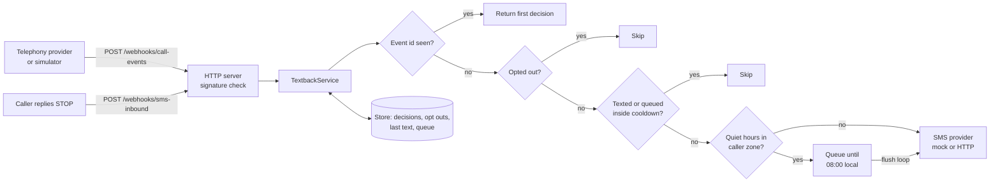

# missed-call-textback

When a service business misses a call, the caller usually rings the next company on the list.
This texts that caller back as soon as the phone system reports the missed call ("Sorry we missed your call. Reply here and we will get right back to you.") so the conversation stays with you.

It is built for plumbers, electricians, remodelers, cleaners and other small crews who cannot always pick up. The hard part is not sending a text. It is never sending the wrong one:

- **One text, not five.** Call three times in a day and you still get one text.
- **No texts at night.** A call at 23:40 is answered by text at 08:00 the caller's local time, not the business's.
- **STOP means stop.** A caller who opts out is never texted again, even if a text was already waiting to go.
- **No repeats from a glitchy phone system.** Phone providers often report the same call twice. The second report sends nothing.

Under the hood it is a small TypeScript webhook service (Node 22, no third party libraries in the service code) with 34 automated tests and a simulator. It is a working reference build, not a hosted product: it runs offline against a mock SMS provider and has never been connected to a live phone or SMS service. See [Limitations](#limitations).

## What you will see

`npm run demo` replays one made up day of calls and prints what the service decided for each. Real output, trimmed to six of the 34 rows (full capture in [`demo/output.txt`](demo/output.txt)):

```text
Eastern   | event         | event id | caller                          | caller local | result
07:30 EDT | call.missed   | evt_0002 | Lane Nightowl +18085550112      | 01:30 HST    | QUEUED until 08:00 HST (quiet hours for the caller)
09:05 EDT | call.missed   | evt_0003 | Morgan Stopper +12125550113     | 09:05 EDT    | SENT msg_0001
09:20 EDT | sms inbound   |          | Morgan Stopper +12125550113     | 09:20 EDT    | "STOP" -> opted out
10:00 EDT | call.missed   | evt_0005 | Lane Nightowl +18085550112      | 04:00 HST    | SKIPPED_ALREADY_TEXTED: a text to this caller is already queued
14:00 EDT | queue release | evt_0002 | Lane Nightowl +18085550112      | 08:00 HST    | SENT msg_0005 (was queued)
15:00 EDT | call.missed   | evt_0015 | Morgan Stopper +12125550113     | 15:00 EDT    | SKIPPED_OPTED_OUT: caller is on the opt out list
```

The run ends by checking its own send log and exits non zero if any check fails:

```text
Invariant checks
  [PASS] one decision per provider event id
  [PASS] redeliveries sent nothing extra
  [PASS] no number texted twice inside the cooldown window
  [PASS] no text sent during the recipient's quiet hours
  [PASS] no text sent to a number after it opted out
  [PASS] every caller with a missed call who never opted out got exactly one text
```

All names and numbers are invented; the phone numbers use the reserved 555-01xx range.

## The rules in detail

On a `call.missed` event it sends one text back to the caller, subject to four rules:

- **Idempotent on the provider event id.** Webhook redeliveries, including concurrent ones, return the first result and send nothing.
- **No double text.** A caller gets at most one text per cooldown window (24 hours by default), however many times they call. A queued text counts.
- **Opt out list.** A caller who replies STOP (or STOPALL, UNSUBSCRIBE, CANCEL, END, QUIT, REVOKE, OPT OUT) is never texted. START or UNSTOP opts back in. The reply must be the keyword alone; case, spacing and punctuation are ignored, so `Stop.` counts and `stop by at 5` does not.
- **Quiet hours by time zone.** Between 21:00 and 08:00 in the caller's own zone the text is queued and released at 08:00 local. The zone comes from `callerTimeZone` on the event, else the area code, else a default. If the caller opts out while the text is queued, it is dropped.

If the SMS provider fails, the event is not recorded and the webhook answers 502, so a telephony provider that retries on 5xx responses gets the text sent on its retry. There is no telephony integration: any system that can POST the JSON shown under [Run it](#run-it) can drive the service. The SMS side is an interface with an offline mock (default) and a generic HTTP client.

## Architecture



| File | Role |
| --- | --- |
| `src/service.ts` | The decision rules, the queue flush and STOP handling |
| `src/quietHours.ts` | Time zone math, area code lookup, phone normalization |
| `src/store.ts` | In memory state with an optional JSON snapshot |
| `src/sms.ts` | `MockSmsProvider` and `HttpSmsProvider` |
| `src/server.ts` | HTTP routes and HMAC signature check |
| `src/simulator.ts` | Generates and replays a day of fake call events |

## Run it

Needs Node 22 or newer. No keys or accounts. `npm install` pulls three dev dependencies (TypeScript, tsx, Node types).

```bash
npm install
npm run demo     # replay a simulated day, offline
npm start        # webhook server on :8787 with the mock SMS provider
```

With the server running:

```bash
curl -s -X POST localhost:8787/webhooks/call-events -H 'content-type: application/json' \
  -d '{"eventId":"evt_1","type":"call.missed","from":"+12125550101","to":"+12125550100","occurredAt":"2026-03-11T14:00:00Z"}'
```

The first response has `"outcome":"sent"` (or `"deferred"` if it is currently between 21:00 and 08:00 US Eastern, since the service uses the real clock). Send it again: the second response carries `"duplicate":true` and no second text goes out. The quoting above is for bash; in PowerShell put the JSON in a file and use `curl.exe --data-binary "@event.json"`. Configuration is optional and documented in `.env.example` (export the variables or pass them inline; the service does not read `.env` by itself).

## Tests

```bash
npm test
```

This type checks the project and runs 34 tests with the Node test runner: the rules one by one, races between concurrent deliveries and overlapping queue flushes, opt out keyword parsing, daylight saving changes, the HTTP layer with signatures, the HTTP SMS client against a local stub, restart persistence, and the simulator invariants across 40 seeds. CI runs the same command plus the demo (`.github/workflows/ci.yml`).

## Demo

`npm run demo` builds one synthetic day of provider traffic from a seeded random generator (about 30 webhook deliveries from 16 fake callers in five time zones, with redeliveries, answered calls, STOP replies and late night calls), replays it against the real service with a virtual clock, and then verifies six invariants from the mock provider's send log. It exits non zero if any invariant fails. Try another day with `npm run demo -- --seed=7`.

The captured run for the default seed is in [`demo/output.txt`](demo/output.txt), and an excerpt is at the top of this page. The last two rows of the full log are queue releases on the following morning.

## Where this pattern runs

This is a clean room reduction of a pattern drawn from systems that run two small service companies day to day, where a missed call is a missed job and a second or late night text is a complaint. Those systems sit behind a real telephony provider and a database. None of that code, data or traffic is in this repository: what is here is the rules and their ordering, and the only evidence offered for them is the tests and the simulator.

## Limitations

- Nothing here has handled a real call or sent a real text. The telephony provider does not exist in this repo (the simulator and `curl` stand in for it), the default SMS provider is an in memory mock, and every run and test is offline.
- State lives in memory. `STATE_FILE` adds a JSON snapshot rewritten on every change, which is fine for one process and small volumes. It is not a database, and running two instances would break both the idempotency and the no double text guarantees.
- The time zone guess from an area code uses a table of 14 sample codes and falls back to the default zone, as does every number outside the US and Canada. Area codes also say nothing about where a mobile phone actually is. Pass `callerTimeZone` when the provider knows better.
- Phone normalization is US and Canada oriented.
- The event shape is this project's own. A real provider needs a small adapter, and its signature scheme will differ from the plain HMAC SHA256 of the body used here.
- `HttpSmsProvider` is a generic JSON client tested only against a local stub, never against a live SMS API. Its request shape (bearer key, `idempotency-key` header, `{to, from, body}`) matches no particular vendor, so a real one needs its own client.
- `occurredAt` is accepted but not used. Decisions run on the time the webhook arrives, so an event the provider delivers hours late still gets a "sorry we missed your call" text.
- If a send fails while a second, different event from the same caller arrives, that second event is recorded as already texted. The caller still gets a text only if the provider retries the first event.
- If the process dies between the SMS provider accepting a message and the decision being saved, the redelivered event is sent again with the same idempotency key. Exactly one text then depends on the SMS provider honoring that key.
- Queued texts are released by a 30 second timer, so they can go out up to 30 seconds after quiet hours end. A queued send that keeps failing is retried on every tick with no backoff or dead letter.
- No rate limiting, authentication beyond the webhook signature, HELP keyword reply, or opt out sync with a carrier level block list. There is no check that the number is a mobile, so landlines get a text that goes nowhere.
- The 21:00 to 08:00 default and the STOP handling are sensible defaults, not a compliance guarantee. Consent rules, sender registration and local texting law are the operator's job.

License: MIT, see the LICENSE file.
