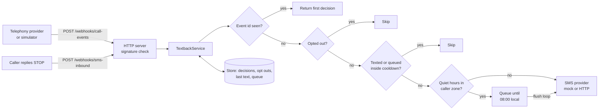

# missed-call-textback

A small service business loses the job when a call goes to voicemail and nobody follows up.
This webhook service texts the caller back once, and only when it is polite and permitted to do so.

## What it does

On a `call.missed` event from a telephony provider it sends one text back to the caller, subject to four rules:

- **Idempotent on the provider event id.** Webhook redeliveries, including concurrent ones, return the first result and send nothing.
- **No double text.** A caller gets at most one text per cooldown window (24 hours by default), however many times they call. A queued text counts.
- **Opt out list.** A caller who replied STOP (or UNSUBSCRIBE, CANCEL, END, QUIT) is never texted. START opts back in.
- **Quiet hours by time zone.** Between 21:00 and 08:00 in the caller's own zone the text is queued and released at 08:00 local. The zone comes from `callerTimeZone` on the event, else the area code, else a default. If the caller opts out while the text is queued, it is dropped.

If the SMS provider fails, the event is not recorded and the webhook answers 502, so the provider's retry sends the text. The telephony provider is mocked: any system that can POST the JSON below can drive it. The SMS side is an interface with an offline mock (default) and a generic HTTP client.

## Architecture



| File | Role |
| --- | --- |
| `src/service.ts` | The decision rules, the queue flush and STOP handling |
| `src/quietHours.ts` | Time zone math, area code lookup, phone normalization |
| `src/store.ts` | In memory state with an optional JSON snapshot |
| `src/sms.ts` | `MockSmsProvider` and `HttpSmsProvider` |
| `src/server.ts` | HTTP routes and HMAC signature check |
| `src/simulator.ts` | Generates and replays a day of fake call events |

## Run it

Needs Node 22 or newer. No keys or accounts.

```bash
npm install
npm run demo     # replay a simulated day, offline
npm start        # webhook server on :8787 with the mock SMS provider
```

With the server running:

```bash
curl -s -X POST localhost:8787/webhooks/call-events -H 'content-type: application/json' \
  -d '{"eventId":"evt_1","type":"call.missed","from":"+12125550101","to":"+12125550100","occurredAt":"2026-03-11T14:00:00Z"}'
```

Send it twice: the second response carries `"duplicate": true` and no second text goes out. Configuration is optional and documented in `.env.example` (export the variables or pass them inline; the service does not read `.env` by itself).

## Tests

```bash
npm test
```

This type checks the project and runs 32 tests with the Node test runner: the rules one by one, races between concurrent deliveries, daylight saving changes, the HTTP layer with signatures, the HTTP SMS client against a local stub, restart persistence, and the simulator invariants across 40 seeds. CI runs the same command plus the demo (`.github/workflows/ci.yml`).

## Demo

`npm run demo` builds one synthetic day of provider traffic from a seeded random generator (about 30 webhook deliveries from 16 fake callers in five time zones, with redeliveries, answered calls, STOP replies and late night calls), replays it against the real service with a virtual clock, and then verifies six invariants from the mock provider's send log. It exits non zero if any invariant fails. Try another day with `npm run demo -- --seed=7`.

Captured output is in [`demo/output.txt`](demo/output.txt). An excerpt:

```text
07:30 EDT | call.missed   | evt_0002 | Lane Nightowl +18085550112      | 01:30 HST    | QUEUED until 08:00 HST (quiet hours for the caller)
09:05 EDT | call.missed   | evt_0003 | Morgan Stopper +12125550113     | 09:05 EDT    | SENT msg_0001
09:20 EDT | sms inbound   |          | Morgan Stopper +12125550113     | 09:20 EDT    | "STOP" -> opted out
10:00 EDT | call.missed   | evt_0005 | Lane Nightowl +18085550112      | 04:00 HST    | SKIPPED_ALREADY_TEXTED: a text to this caller is already queued
14:00 EDT | queue release | evt_0002 | Lane Nightowl +18085550112      | 08:00 HST    | SENT msg_0005 (was queued)
15:00 EDT | call.missed   | evt_0015 | Morgan Stopper +12125550113     | 15:00 EDT    | SKIPPED_OPTED_OUT: caller is on the opt out list
```

The last two rows of the full log are queue releases on the following morning. All names and numbers are invented; the phone numbers use the reserved 555-01xx range.

## Where this pattern runs

This is a clean room reduction of a pattern drawn from systems that run two small service companies day to day, where a missed call is a missed job and a second or late night text is a complaint. The production versions sit behind a real telephony provider and a database; the rules and their ordering are the part worth showing, and they are the same here.

## Limitations

- State lives in memory. `STATE_FILE` adds a JSON snapshot rewritten on every change, which is fine for one process and small volumes. It is not a database, and running two instances would break both the idempotency and the no double text guarantees.
- The time zone guess from an area code uses a table of 14 sample codes and falls back to the default zone. Area codes also say nothing about where a mobile phone actually is. Pass `callerTimeZone` when the provider knows better.
- Phone normalization is US and Canada oriented.
- The event shape is this project's own. A real provider needs a small adapter, and its signature scheme will differ from the plain HMAC SHA256 of the body used here.
- `HttpSmsProvider` is a generic JSON client tested only against a local stub, never against a live SMS API.
- If the process dies between the SMS provider accepting a message and the decision being saved, the redelivered event is sent again with the same idempotency key. Exactly one text then depends on the SMS provider honoring that key.
- Queued texts are released by a 30 second timer, so they can go out up to 30 seconds after quiet hours end. A queued send that keeps failing is retried on every tick with no backoff or dead letter.
- No rate limiting, authentication beyond the webhook signature, or opt out sync with a carrier level block list.

License: MIT, see the LICENSE file.
